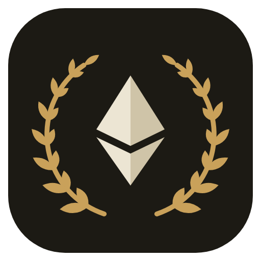
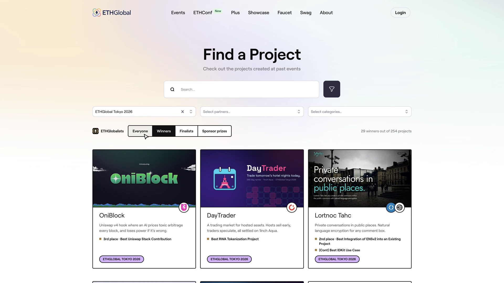
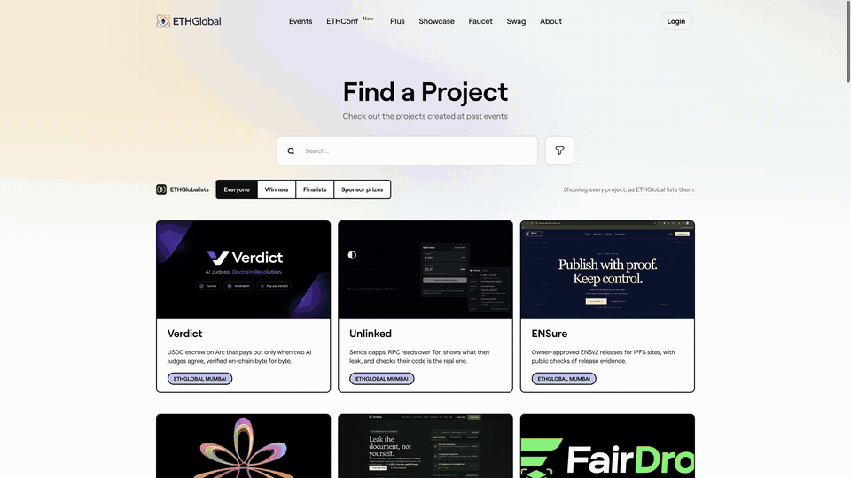

<p align="center">
  
</p>

<h1 align="center">ETHGlobalists</h1>

<p align="center">A Chrome extension that shows only the winners on the <a href="https://ethglobal.com/showcase">ETHGlobal showcase</a>.</p>



The showcase lists every project, 33 to a page, and most of them didn't win a prize. Finding the winners of an event means paging through all of them and squinting for the small prize badge.

ETHGlobalists adds a switch under the showcase's search box. Pick Winners and the page shows only projects that won something, each card listing its prizes and the sponsors behind them. ETHGlobal's own event, partner, category and search filters stay in charge; the extension reads them from the URL and follows along.



## What it does

- Four modes: Everyone (the page as ETHGlobal ships it), Winners (any prize), Finalists, and Sponsor prizes (partner, track and tier prizes).
- Winners from every page of results show up together, and more load as you scroll.
- Each card lists its prizes, finalists first and then by place, with the sponsor logos on the banner like ETHGlobal's own cards.
- The status line says how many winners were found and how many projects were checked, so you know when you've seen all of them.
- Coming back from a project page puts you where you were, with the same winners loaded.
- Works with the keyboard (arrow keys move between modes) and respects reduced motion.

## Getting started

Not on the Chrome Web Store yet. Load it unpacked:

1. Download this repo (Code, then Download ZIP) and unzip it, or `git clone https://github.com/adilhusain01/ETHGlobalists.git`.
2. Open `chrome://extensions` and turn on Developer mode (top right).
3. Click Load unpacked and pick the `ETHGlobalists` folder (the one with `manifest.json`).
4. Open [ethglobal.com/showcase](https://ethglobal.com/showcase) and pick Winners under the search box.

The toolbar icon opens the same switch. It's tested in Chrome; other Chromium browsers load unpacked extensions the same way.

To update, pull or download the repo again and click the reload arrow on the extension's card in `chrome://extensions`.

## How it works

The showcase keeps its filters in the URL (`events`, `partners`, `categories`, `q`). When a winners mode is on, the content script reads those filters and asks ETHGlobal's public GraphQL API (`api.ethglobal.com/graphql`, the same one the site uses) for the matching projects with their prizes, 120 first and then 250 at a time. It keeps the ones with a prize and draws them in place of the paginated grid. ETHGlobal's grid and pager are hidden with one CSS rule, not removed, so switching back to Everyone shows the page exactly as it was.

The extension asks for one permission, `storage`, to remember which mode you picked. It runs only on `ethglobal.com`, has no background worker, sends nothing anywhere except ETHGlobal's own API, and collects no data.

If ETHGlobal changes its page structure or API, the extension may stop finding the search box or the prizes. Open an issue with a screenshot and it will get fixed.

## Development

There is no build step. The extension is plain JavaScript in `src/`:

| File | What it does |
|---|---|
| `src/core.js` | Pure helpers: reading filters from the URL, sorting and labelling prizes, the status line. Tested. |
| `src/content.js` | The bar, the winners feed, fetching from the API, following URL changes. |
| `src/content.css` | Styles, all scoped under `#ethgl-bar` and `#ethgl-feed`. |
| `src/popup.*` | The toolbar popup. |
| `scripts/logo.mjs` | Draws the logo as SVG (`node scripts/logo.mjs`). |
| `docs/demo/record.sh` | Records the demo video with [agent-browser](https://github.com/vercel-labs/agent-browser). |

```sh
npm test          # node --test, no dependencies
npm run package   # writes dist/ethglobalists-<version>.zip for the Chrome Web Store
```

After editing, click the reload arrow on the extension in `chrome://extensions` and refresh the showcase.

## Licence

MIT. See [LICENSE](LICENSE).

ETHGlobalists is an independent project and is not affiliated with or endorsed by ETHGlobal. Project names, banners and sponsor logos shown by the extension come from ETHGlobal's showcase and belong to their owners.
